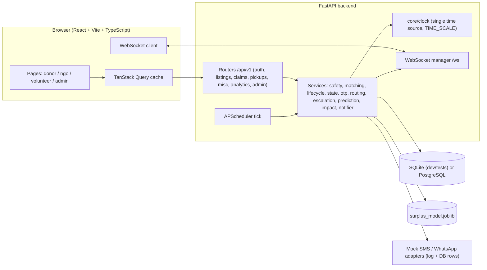

# Architecture

## Layers
| Layer | Responsibility | Code |
|---|---|---|
| API | validation (Pydantic), auth + role checks, error envelope `{"error":{"code","message"}}` | `app/api`, `app/schemas`, `app/core/deps.py` |
| Services | all business rules, no HTTP knowledge | `app/services` |
| Persistence | SQLAlchemy models, Alembic migration | `app/db`, `alembic/` |
| Automation | periodic escalation / expiry / re-assignment | `app/jobs/scheduler.py` |
| Realtime | per-user WebSocket push after commit | `services/realtime.py`, `api/ws.py` |

## Key design choices
- **One clock** (`core/clock.py`): every business timestamp goes through it, so tests freeze time and demos run with `TIME_SCALE=60` to show 30 simulated minutes in 30 real seconds. Auth tokens and rate limits use real time (D7).
- **Concurrency**: first valid claim wins. PostgreSQL uses `SELECT ... FOR UPDATE` plus an atomic conditional update; SQLite serialises writers with `BEGIN IMMEDIATE` (D8). A two-thread test asserts exactly one 201 and one 409.
- **Privacy**: listings show an approximate location (rounded coordinates, no address) until a claim/assignment makes the exact location necessary (`services/serializers.py`).
- **Explainable matching**: `listing_match_scores.components` stores the five weighted components, which the UI shows as "Why these NGOs?".
- **Frontend state**: REST is the source of truth; WebSocket events only invalidate queries and raise a toast.
