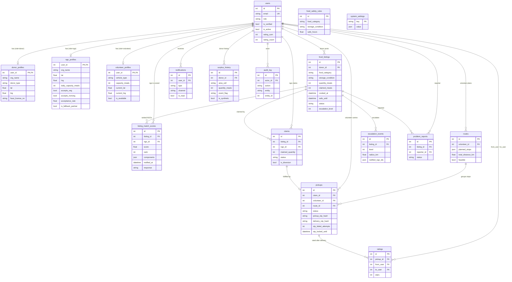

# Entity-relationship diagram

Source of truth: `backend/app/db/models.py` (17 tables) and the Alembic migration. Render with any Mermaid viewer (GitHub, VS Code Mermaid extension, mermaid.live).

Notes
- `food_safety_rules` and `system_settings` are standalone configuration tables (admin-editable safe hours and match weights).
- Only password hashes (bcrypt) and OTP hashes are stored for verification; the plain OTP is kept only until used, solely so the donor / NGO can display it (decision D6).
