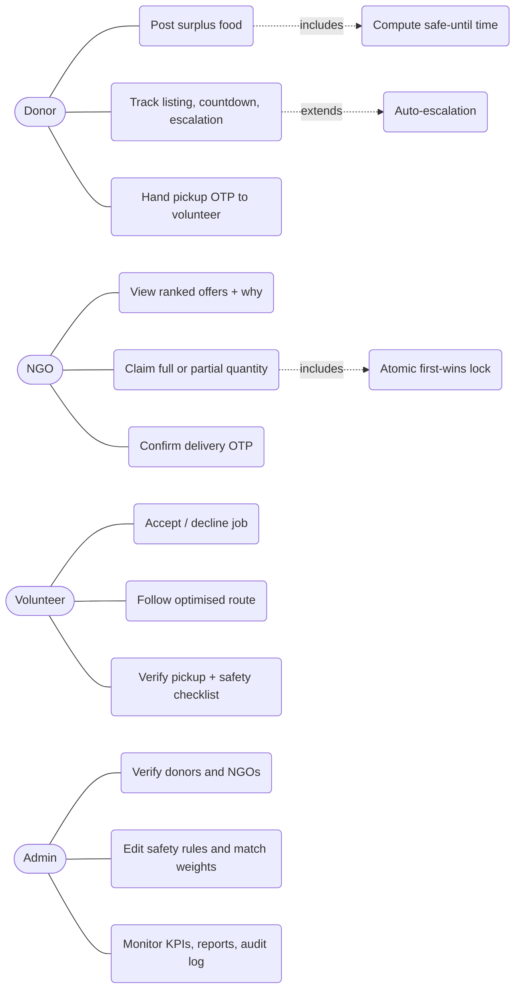
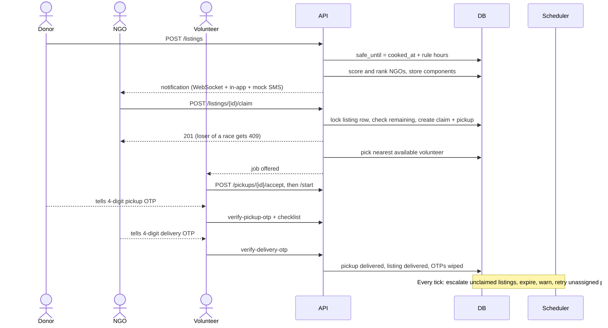
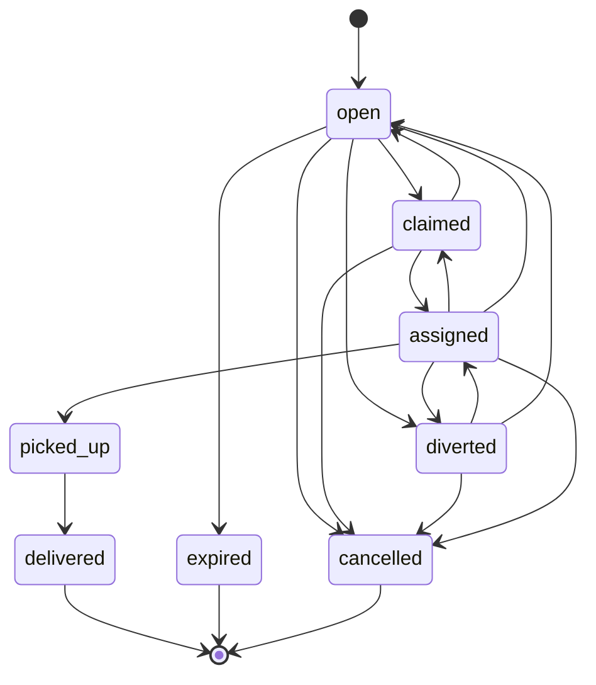
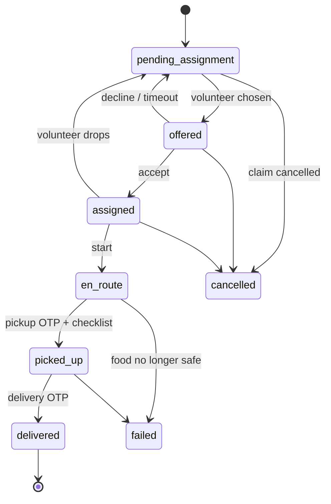
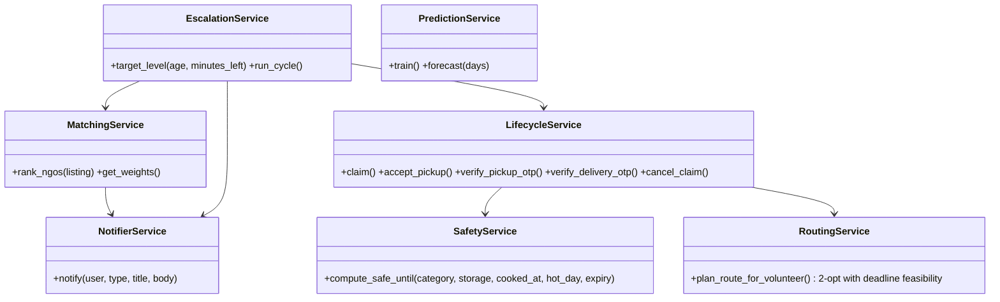

# UML

## Use cases

## Sequence: post, match, claim, deliver

## State machine: listing (`services/state.py`)

Illegal transitions raise HTTP 409 `illegal_transition`.

## State machine: pickup (`services/lifecycle.py`)

After 5 wrong OTP attempts the pickup is locked for 10 minutes.

## Class view (services)

